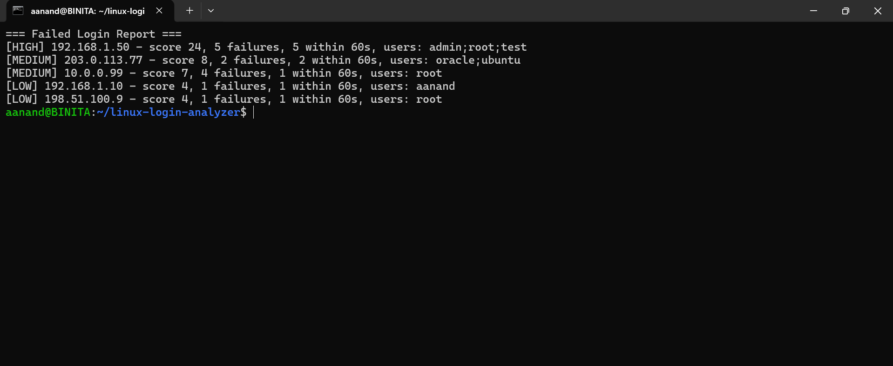

# Linux Failed Login Analyzer

A Python tool that reads a Linux auth.log, finds failed SSH logins, counts attempts per source IP, and flags suspicious activity with a severity rating.

## Objective

Practice the core SOC skill of turning raw log data into an investigation: extract evidence, count it, decide what is suspicious, and report it.

## Tools

- Linux (WSL)
- Python 3
- Git and GitHub

## How it works

1. Reads data/sample_auth.log line by line.
2. Uses a regular expression to pull the username and source IP from each Failed password line.
3. Counts failures per IP and records which usernames each IP tried.
4. Assigns a severity:
   - HIGH: 5 or more failures, or 3 or more different usernames
   - MEDIUM: 2 or more failures
   - LOW: anything else
5. Prints the report and saves it to reports/report.txt.

## Run it

Run: python3 src/analyzer.py

## Sample data

data/sample_auth.log contains 15 SSH log lines I created to simulate: one brute-force burst, a username-guessing scan, a slow trickle of failures, normal user typos, and successful logins.

## Detection logic

- HIGH: 5 or more failures, OR 3 or more different usernames, OR 5 or more failures inside 60 seconds
- MEDIUM: 2 or more failures
- LOW: anything else
- Risk score = 1 point per failure + 3 points per distinct username + 10 points for a burst

## Output

- reports/report.txt: human-readable report, highest risk first
- reports/report.csv: the same data for Excel or other tools

## Findings

- 192.168.1.50 (score 24, HIGH): 5 failures in 12 seconds against root, admin and test. This is a brute-force pattern.
- 203.0.113.77 (score 8, MEDIUM): tried the nonexistent usernames oracle and ubuntu, which suggests scanning for common accounts.
- 10.0.0.99 (score 7, MEDIUM): 4 failures spread over 4 hours. Slow and low, so not a burst.
- 192.168.1.10 and 198.51.100.9 (score 4, LOW): single failures, likely typos.

## What I learned

- How SSH authentication lines in auth.log are structured
- Extracting fields with regular expressions
- Counting and grouping with dictionaries and sets
- A sliding time window to separate bursts from slow activity
- Debugging: a missing IP in the report led me to a log line that had been merged by mistake
- Git workflow: change, commit, push

## Future improvements

- Check IPs against a reputation service
- Read a real auth.log and handle the year automatically
- Add command-line options for the file path and thresholds
- Detect a successful login that follows many failures from the same IP

## Screenshot

## How this was built

I built this project while learning Python and Linux, working step by step with Claude (an AI assistant) as a tutor. Claude wrote the initial code, and I ran it, tested it, debugged it (including finding a merged log line that dropped an IP from the report), and wrote up the findings. Next I'm extending it with features I write myself.
